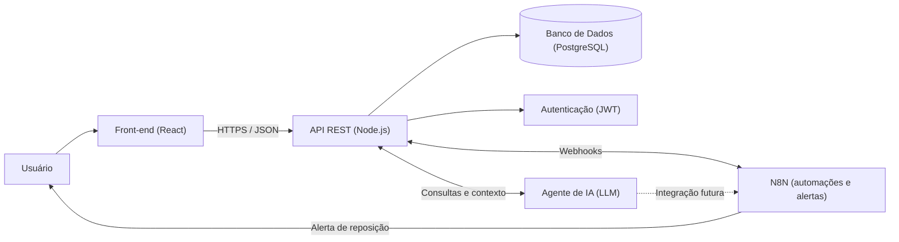

# 3. Arquitetura da Solução – SmartStock

## 3.1 Componentes

| Componente | Responsabilidade |
|---|---|
| **Usuário** | Acessa o sistema pelo navegador. |
| **Front-end (React)** | Telas de login, dashboard, produtos, movimentações, relatórios e configurações. |
| **API REST (Node.js)** | Regras de negócio, autenticação (JWT) e acesso aos dados. |
| **Banco de Dados (PostgreSQL)** | Armazena produtos, movimentações e usuários. |
| **N8N** | Automações: envio de alertas de reposição e integrações externas (futuro). |
| **Agente de IA (LLM)** | Consultas em linguagem natural e apoio à decisão (futuro, Dia 9). |

## 3.2 Fluxograma

## 3.3 Fluxo de um alerta de reposição
1. Usuário registra uma saída pelo front-end.
2. A API atualiza a quantidade em `produtos` e grava em `movimentacoes`.
3. Se `quantidade <= estoque_minimo`, a API envia um webhook ao N8N.
4. O N8N notifica o responsável (e-mail ou mensagem).

## 3.4 Pontos de integração futura
- **N8N:** ponto de entrada para automações (alertas, relatórios agendados).
- **Agente de IA:** acessa a API via endpoints de leitura (saldo, histórico, previsões), sem acesso direto ao banco.
